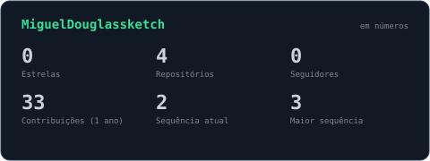
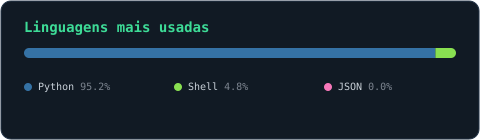

<picture>
  <source media="(prefers-color-scheme: dark)"  srcset="https://raw.githubusercontent.com/MiguelDouglassketch/MiguelDouglassketch/output/pacman-contribution-graph-dark.svg">
  <source media="(prefers-color-scheme: light)" srcset="https://raw.githubusercontent.com/MiguelDouglassketch/MiguelDouglassketch/output/pacman-contribution-graph.svg">
  
</picture>

 

# Miguel Douglas

**Python · SQL · Análise de dados**
 
Estudante de Análise e Desenvolvimento de Sistemas · Profissional de TI · Recife, PE

 

&nbsp;

---

## Sobre mim

Trabalho na área de TI de um órgão público federal, em Recife, com contato direto com a rotina de suporte e sistemas de uma grande instituição. Em paralelo, curso Análise e Desenvolvimento de Sistemas, com foco em segurança da informação e banco de dados.

## Formação

| Curso | Instituição | Situação |
|---|---|---|
| Análise e Desenvolvimento de Sistemas | Estácio | Em andamento |
| Técnico em Redes de Computadores | ETE | Concluído |

## Stack e habilidades

  

<table>
  <tr>
    <td align="center" valign="middle">
      <picture>
        <source media="(prefers-color-scheme: dark)"  srcset="assets/radar-dark.svg">
        <source media="(prefers-color-scheme: light)" srcset="assets/radar-light.svg">
        
      </picture>
    </td>
    <td align="center" valign="middle">
      <picture>
        <source media="(prefers-color-scheme: dark)"  srcset="assets/card-stats-dark.svg">
        <source media="(prefers-color-scheme: light)" srcset="assets/card-stats-light.svg">
        
      </picture>
       
      <picture>
        <source media="(prefers-color-scheme: dark)"  srcset="assets/card-langs-dark.svg">
        <source media="(prefers-color-scheme: light)" srcset="assets/card-langs-light.svg">
        
      </picture>
    </td>
  </tr>
</table>

## Projetos

> Atualizado automaticamente a cada 6 horas com meus repositórios mais recentes.

<!--PROJECTS:START-->
| Projeto | Descrição | Tecnologia |
|---|---|---|
| [Ferramentas-de-Suporte-TI](https://github.com/MiguelDouglassketch/Ferramentas-de-Suporte-TI) | Ferramentas para diagnóstico de sistema e rede | Python |
| [Sistema-de-Chamados-Help-Desk](https://github.com/MiguelDouglassketch/Sistema-de-Chamados-Help-Desk) | Sistema de chamados de help desk no terminal, com dados salvos em JSON | Python |
<!--PROJECTS:END-->

## Foco atual

- Aprender Python
- Estudar cibersegurança
- Praticar Git e GitHub
- Desenvolvimento de APIs
- Banco de dados SQL
- Suporte técnico e infraestrutura
- Linux e automação

 

